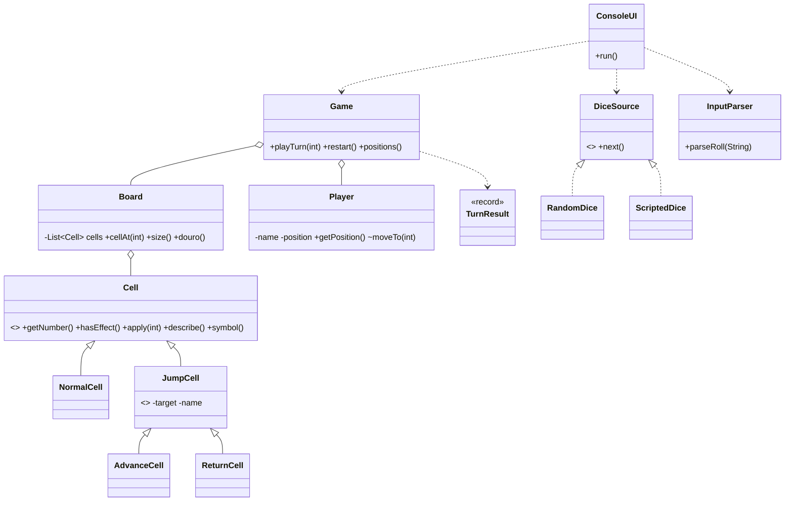

# Corrida do Douro — regras, mapa e design (checkpoint de outubro, rascunho)

## Regras
- 2 jogadores, tabuleiro de 30 casas (1–30); início = posição 0 (fora do tabuleiro). Joga primeiro o Jogador 1, depois alternam.
- Dado 1–6: aleatório ou manual (escolhido no início). Ambos chamam `Game.playTurn(int)`.
- Entrada manual inválida: mensagem de erro, estado inalterado, mesmo jogador joga de novo.
- **Meta:** chegar à casa 30 ou ultrapassá-la (ultrapassar = vitória, peão fica na 30).
- **Casas partilhadas:** os dois peões podem estar na mesma casa; não há captura.
- **Efeitos:** avançar (+) e recuar (−) para casa fixa. Efeitos encadeiam-se (máx. 5 por turno).
  Os alvos de recuo são sempre ≥ 1, logo nunca saem do tabuleiro.
- **Fim sem jogo infinito:** limite de 30 rondas; vence quem estiver mais avançado, igualdade = empate.
- Comandos: `q` sair, `r` recomeçar (em qualquer momento).

## Mapa de efeitos
| Casa | Efeito | Destino |
| --- | --- | --- |
| 3 | + Eléctrico 22 | 8 |
| 9 | + Barco Rabelo | 14 |
| 10 | + Funicular dos Guindais | 15 |
| 19 | + Metro D. Luís I | 24 |
| 22 | + Vento a favor | 27 |
| 14 | − Nevoeiro | 10 |
| 17 | − Escadas da Ribeira | 11 |
| 25 | − Maré cheia | 20 |
| 28 | − Greve de transportes | 21 |

Cadeia exemplo: casa 9 → 14 → 10 → 15 (3 efeitos num turno).

## Tabela de representações (a completar com o mockup)
| Conceito | Consola | Modelo | Mockup |
| --- | --- | --- | --- |
| Peão do J1 na casa 22 | `[22+ 1]` | `Player("J1").getPosition()==22` | peão azul sobre o eléctrico (por criar) |
| Estado dos dois peões | `Posições (22, 24)` | `game.positions()` → `"(22, 24)"` | — |
| Casa de avanço | `+` | `AdvanceCell` | seta/transporte (por criar) |
| Casa de recuo | `-` | `ReturnCell` | nevoeiro/escadas (por criar) |
| Vitória | "chegou à meta" | `game.isFinished()`, `getWinner()` | ecrã de vitória (por criar) |

## UML (inicial)

Justificações: herança em `Cell` (polimorfismo de `apply`), `JumpCell` evita duplicar a lógica de destino;
`DiceSource` permite dados reais e programados; sobrecarga de construtor `Player(String)`/`Player(String,int)`
para definir estados iniciais nos testes; `List<Cell>`/`List<Player>` tipadas.

## Distribuição de tarefas (proposta — ajustem)
| Área | Estudante A | Estudante B |
| --- | --- | --- |
| Modelo | `Cell`, `JumpCell`, `AdvanceCell`, `ReturnCell`, `Board` | `Player`, `Game`, `TurnResult` |
| Dados / entrada | `DiceSource`, `RandomDice`, `ScriptedDice` | `InputParser`, `ConsoleUI` |
| Testes | testes de efeitos, fronteiras, encadeamento | testes de dados, entrada inválida, fim, reinício |
| Docs / arte | regras, mapa, mockup | UML, relatório, AI_USE.md |
Revisão cruzada: cada um revê (PR) o código do outro. Contar linhas de produção e de teste em separado.

## Estado
Funciona: regras, consola, ambos os modos, efeitos, validação, reinício, 25 verificações (todas PASS).
Falta: cabeçalhos com nomes/números, AI_USE.md, mockup, relatório, mais testes e commits no GitHub.
